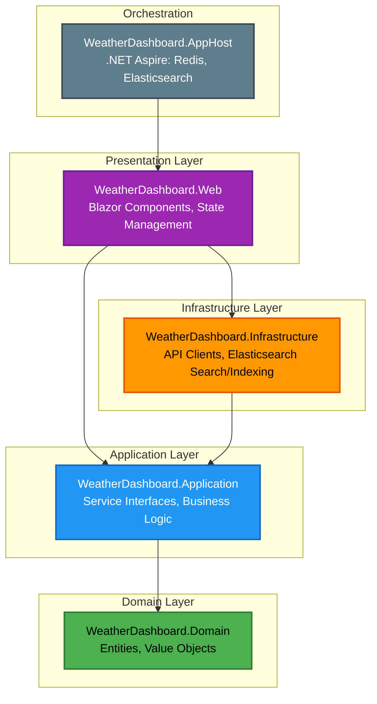
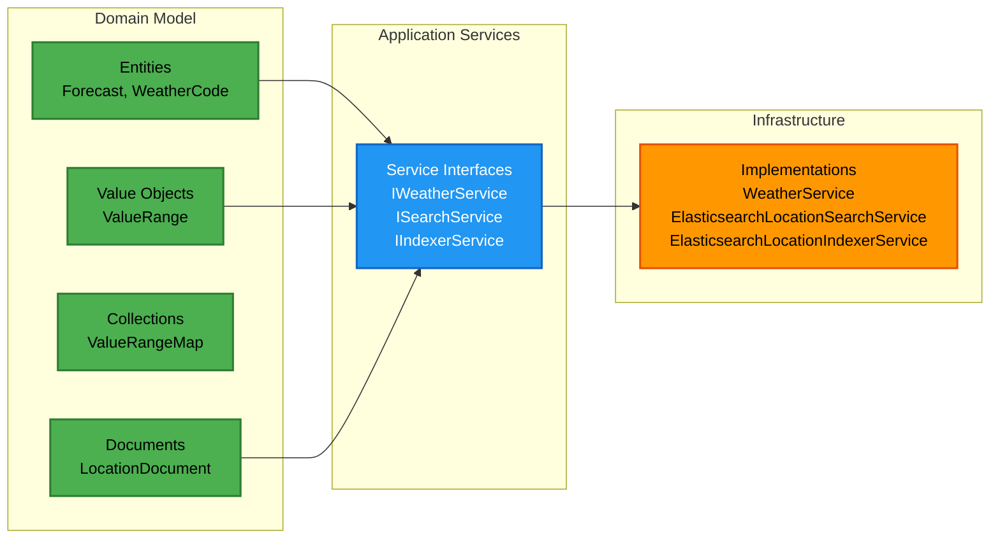
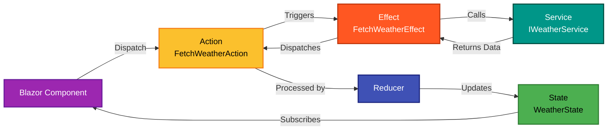

# Weather Dashboard Blazor Demo

[](https://dotnet.microsoft.com/)
[](https://dotnet.microsoft.com/apps/aspnet/web-apps/blazor)
[](https://aspire.dev/)


A modern, interactive weather dashboard built with Blazor Server, demonstrating Clean Architecture principles, Domain-Driven Design patterns, and state-of-the-art .NET development practices.

<details>
<summary>Table of Contents</summary>

- [General Overview](#general-overview)
- [Project Structure](#project-structure)
  - [Solution File](#solution-file)
  - [Project Files](#project-files)
  - [Directory Structure](#directory-structure)
- [Prerequisites](#prerequisites)
- [Dependencies](#dependencies)
  - [Domain Layer](#domain-layer)
  - [Application Layer](#application-layer)
  - [Infrastructure Layer](#infrastructure-layer)
  - [Web Layer](#web-layer)
  - [AppHost](#apphost)
- [Architecture](#architecture)
  - [Clean Architecture](#clean-architecture)
  - [Domain-Driven Design](#domain-driven-design)
  - [Flux Pattern (State Management)](#flux-pattern-state-management)
- [Getting Started](#getting-started)
  - [Local Development](#local-development)
  - [Running with Aspire](#running-with-aspire)
- [Configuration](#configuration)
  - [Cookie Settings](#cookie-settings)
  - [Default Location](#default-location)
  - [Local Storage](#local-storage)
  - [Localization](#localization)
  - [Aspire Resources](#aspire-resources)
- [External Services](#external-services)
  - [Open-Meteo Weather API](#open-meteo-weather-api)
- [Implementation Details](#implementation-details)
  - [Mapping Strategies](#mapping-strategies)
  - [Caching Strategy](#caching-strategy)
  - [Search Implementation](#search-implementation)
  - [Security](#security)
- [Testing](#testing)
  - [Running Tests](#running-tests)
  - [Test Framework](#test-framework)
  - [Code Coverage](#code-coverage)
- [Code Quality](#code-quality)

</details>

## General Overview

Weather Dashboard is a production-ready demonstration of enterprise-grade .NET application development, showcasing:

- **Clean Architecture** with strict layer separation and dependency inversion
- **Blazor Server** with interactive server-side rendering
- **Fluxor** for predictable state management using the Flux pattern
- **.NET Aspire** orchestration for Redis, Elasticsearch, and the developer dashboard
- **Elasticsearch** for full-text location search (search-as-you-type locality and postal-code prefix)
- **FusionCache** with multi-level caching (memory + distributed)
- **Open-Meteo API** integration with resilience patterns
- **Radzen Blazor** component library with Material Design
- **Comprehensive testing** with xUnit v3, AwesomeAssertions, snapshot testing, and Testcontainers-based integration tests against a real Elasticsearch instance

The application provides a rich user experience with real-time weather data, location search, and beautiful visualizations, while maintaining maintainability through clean separation of concerns.

## Project Structure

### Solution File

The solution uses the modern XML-based `.slnx` format (requires Visual Studio 2022 17.9+, Rider 2024.1+, or recent .NET CLI):

- `WeatherDashboard.slnx` - Solution file containing all projects and solution items

### Project Files

**Source Projects:**
- `src/WeatherDashboard.AppHost/` - .NET Aspire orchestrator (Redis, Elasticsearch, Web)
- `src/WeatherDashboard.Domain/` - Core domain entities and value objects
- `src/WeatherDashboard.Application/` - Business logic and application services
- `src/WeatherDashboard.Infrastructure/` - External service implementations
- `src/WeatherDashboard.Web/` - Blazor Server web application

**Test Projects:**
- `tests/WeatherDashboard.Domain.UnitTests/` - Domain layer unit tests
- `tests/WeatherDashboard.Application.UnitTests/` - Application layer unit tests
- `tests/WeatherDashboard.Infrastructure.UnitTests/` - Infrastructure layer unit tests
- `tests/WeatherDashboard.Infrastructure.IntegrationTests/` - Infrastructure integration tests
- `tests/WeatherDashboard.Web.UnitTests/` - Web layer unit tests
- `tests/WeatherDashboard.Web.UiTests/` - UI component tests with bUnit

### Directory Structure

```
src/
├── WeatherDashboard.AppHost/  # Aspire orchestrator (AppHost.cs, aspire.config.json)
├── WeatherDashboard.Domain/
│   ├── Collections/         # Specialized collections (ValueRangeMap)
│   ├── Common/             # Shared types and base classes
│   ├── Entities/           # Domain entities (Weather, Documents)
│   ├── Serialization/      # JSON serializer contexts
│   └── ValueObjects/       # Domain value objects
├── WeatherDashboard.Application/
│   ├── Common/
│   │   ├── Extensions/     # Extension methods (WeatherCodeExtensions)
│   │   ├── Interfaces/     # Service interfaces
│   │   ├── Serialization/  # JSON/MessagePack converters
│   │   └── Utilities/      # Utility classes (HashUtility)
│   └── Contracts/          # DTOs and mappers (Riok.Mapperly)
├── WeatherDashboard.Infrastructure/
│   ├── Data/              # Seed data (embedded JSON)
│   ├── Extensions/         # Service registration
│   ├── Providers/          # SystemTimeProvider
│   ├── Serialization/      # Weather API serialization contexts
│   └── Services/
│       ├── BackgroundServices/  # LocationIndexerBackgroundService
│       ├── Indexer/            # Elasticsearch indexing + seed-hash metadata
│       ├── Search/             # Elasticsearch search + query sanitizer
│       └── Weather/            # Weather API client + rate limiting
└── WeatherDashboard.Web/
    ├── Configuration/      # Settings classes
    ├── Features/
    │   ├── Common/
    │   │   └── Layouts/       # MainLayout
    │   └── Weather/       # Weather feature components
    │       ├── Components/    # Blazor components
    │       └── StateManagement/  # Fluxor (State/Actions/Effects/Reducers)
    ├── Localizations/     # Resource files (.resx)
    ├── Middlewares/       # QueryCultureCookieMiddleware
    ├── Properties/        # Launch settings
    ├── Resources/         # Static resources
    ├── styles/           # Sass source files
    └── wwwroot/          # Static web assets (fonts, compiled CSS)
```

## Prerequisites

- **.NET SDK 10.0.403** exactly ([Download](https://dotnet.microsoft.com/download)) — `global.json` pins this version with `rollForward: disable`
- **pnpm 10.26.0** or later ([Installation](https://pnpm.io/installation))
- **Node.js 18+** (for pnpm and Sass compilation)
- **Visual Studio 2022 17.9+**, **Rider 2024.1+**, or **.NET CLI** (for `.slnx` support)
- **Docker** (or another OCI-compatible container runtime) — required. Aspire runs Redis and Elasticsearch as containers, and the integration tests use Testcontainers
- **(Optional) Aspire CLI** for `aspire run` ([Installation](https://aspire.dev/get-started/install-cli/))
- **(Optional) VS Code Aspire extension** (`microsoft-aspire.aspire-vscode`, recommended in `.vscode/extensions.json`)

### Platform Support

- Windows 10/11, macOS 12+, or Linux (Ubuntu 20.04+, Debian 11+, etc.)
- Development tools: Visual Studio, Rider, VS Code with C# Dev Kit

## Dependencies

The project uses **Central Package Management** (CPM) with all versions defined in `Directory.Packages.props`.

### Domain Layer

The Domain layer has **zero external dependencies** to maintain pure business logic.

### Application Layer

| Package                                                        | Version | Description                                                         |
|----------------------------------------------------------------|---------|---------------------------------------------------------------------|
| [MessagePack](https://www.nuget.org/packages/MessagePack/)     | 3.1.12  | Binary serialization for caching with custom TimeZoneInfo formatter |
| [Riok.Mapperly](https://www.nuget.org/packages/Riok.Mapperly/) | 4.3.1   | Compile-time object mapping for cache contracts                     |

### Infrastructure Layer

| Package                                                                                                                | Version  | Description                                           |
|------------------------------------------------------------------------------------------------------------------------|----------|-------------------------------------------------------|
| [Elastic.Clients.Elasticsearch](https://www.nuget.org/packages/Elastic.Clients.Elasticsearch/)                         | 9.5.3    | Official Elasticsearch .NET client                    |
| [JetBrains.Annotations](https://www.nuget.org/packages/JetBrains.Annotations/)                                         | 2026.2.0 | Code annotations for better IDE analysis              |
| [Microsoft.Extensions.Hosting.Abstractions](https://www.nuget.org/packages/Microsoft.Extensions.Hosting.Abstractions/) | 10.0.14  | Hosted services support                               |
| [Microsoft.Extensions.Http](https://www.nuget.org/packages/Microsoft.Extensions.Http/)                                 | 10.0.14  | HTTP client factory                                   |
| [Microsoft.Extensions.Http.Resilience](https://www.nuget.org/packages/Microsoft.Extensions.Http.Resilience/)           | 10.11.0  | Resilience patterns (retry, circuit breaker, timeout) |
| [Microsoft.Extensions.Logging.Abstractions](https://www.nuget.org/packages/Microsoft.Extensions.Logging.Abstractions/) | 10.0.14  | Logging abstractions                                  |

### Web Layer

| Package                                                                                                                                                  | Version  | Description                                                   |
|----------------------------------------------------------------------------------------------------------------------------------------------------------|----------|---------------------------------------------------------------|
| [Aspire.StackExchange.Redis](https://www.nuget.org/packages/Aspire.StackExchange.Redis/)                                                                 | 13.6.4   | Aspire-integrated Redis client (connection injection, health checks) |
| [Aspire.Elastic.Clients.Elasticsearch](https://www.nuget.org/packages/Aspire.Elastic.Clients.Elasticsearch/)                                             | 13.3.0   | Aspire-integrated Elasticsearch client (connection injection, health checks) |
| [Fluxor.Blazor.Web](https://www.nuget.org/packages/Fluxor.Blazor.Web/)                                                                                   | 6.11.0   | Redux-like state management for Blazor                        |
| [Fluxor.Blazor.Web.ReduxDevTools](https://www.nuget.org/packages/Fluxor.Blazor.Web.ReduxDevTools/)                                                       | 6.11.0   | Redux DevTools integration (dev only)                         |
| [JetBrains.Annotations](https://www.nuget.org/packages/JetBrains.Annotations/)                                                                           | 2026.2.0 | Code annotations for IDE analysis                             |
| [Microsoft.AspNetCore.DataProtection.StackExchangeRedis](https://www.nuget.org/packages/Microsoft.AspNetCore.DataProtection.StackExchangeRedis/)         | 10.0.14  | Data protection key storage in Redis                          |
| [Microsoft.Extensions.Caching.StackExchangeRedis](https://www.nuget.org/packages/Microsoft.Extensions.Caching.StackExchangeRedis/)                       | 10.0.14  | Redis distributed cache                                       |
| [NetEscapades.AspNetCore.SecurityHeaders](https://www.nuget.org/packages/NetEscapades.AspNetCore.SecurityHeaders/)                                       | 1.3.1    | Middleware for adding security headers (CSP, X-Frame-Options) |
| [Radzen.Blazor](https://www.nuget.org/packages/Radzen.Blazor/)                                                                                           | 12.1.8   | UI component library with Material theme and WCAG compliance  |
| [Serilog](https://www.nuget.org/packages/Serilog/)                                                                                                       | 4.4.0    | Structured logging framework                                  |
| [Serilog.AspNetCore](https://www.nuget.org/packages/Serilog.AspNetCore/)                                                                                 | 10.0.0   | ASP.NET Core integration for Serilog                          |
| [Serilog.Enrichers.CorrelationId](https://www.nuget.org/packages/Serilog.Enrichers.CorrelationId/)                                                       | 3.0.1    | Correlation ID enrichment                                     |
| [Serilog.Enrichers.Environment](https://www.nuget.org/packages/Serilog.Enrichers.Environment/)                                                           | 3.0.1    | Environment enrichment                                        |
| [Serilog.Enrichers.Process](https://www.nuget.org/packages/Serilog.Enrichers.Process/)                                                                   | 3.0.0    | Process enrichment                                            |
| [Serilog.Enrichers.Thread](https://www.nuget.org/packages/Serilog.Enrichers.Thread/)                                                                     | 4.0.0    | Thread enrichment                                             |
| [Serilog.Sinks.OpenTelemetry](https://www.nuget.org/packages/Serilog.Sinks.OpenTelemetry/)                                                               | 4.2.0    | OpenTelemetry sink for observability                          |
| [TimeZoneNames](https://www.nuget.org/packages/TimeZoneNames/)                                                                                           | 7.0.0    | IANA/Windows timezone abbreviation lookups (EST, PST, etc.)   |
| [UnitsNet](https://www.nuget.org/packages/UnitsNet/)                                                                                                     | 5.75.1   | Strongly-typed unit conversions (temperature, wind speed)     |
| [ZiggyCreatures.FusionCache](https://www.nuget.org/packages/ZiggyCreatures.FusionCache/)                                                                 | 2.9.0    | Multi-level caching with fail-safe                            |
| [ZiggyCreatures.FusionCache.Backplane.StackExchangeRedis](https://www.nuget.org/packages/ZiggyCreatures.FusionCache.Backplane.StackExchangeRedis/)       | 2.9.0    | Redis backplane for cache invalidation                        |
| [ZiggyCreatures.FusionCache.Serialization.NeueccMessagePack](https://www.nuget.org/packages/ZiggyCreatures.FusionCache.Serialization.NeueccMessagePack/) | 2.9.0    | MessagePack serialization for caching                         |

### AppHost

| Package                                                                                        | Version | Description                                           |
|------------------------------------------------------------------------------------------------|---------|-------------------------------------------------------|
| [Aspire.AppHost.Sdk](https://www.nuget.org/packages/Aspire.AppHost.Sdk/)                       | 13.5.4  | Aspire AppHost project SDK                            |
| [Aspire.Hosting.Elasticsearch](https://www.nuget.org/packages/Aspire.Hosting.Elasticsearch/)   | 13.3.0  | Elasticsearch container resource                      |
| [Aspire.Hosting.Redis](https://www.nuget.org/packages/Aspire.Hosting.Redis/)                   | 13.6.4  | Redis container resource (with RedisInsight)          |

## Architecture

### Clean Architecture

The application follows Clean Architecture principles with strict dependency rules:



**Key Principles:**
- **Domain Layer**: Pure business logic with zero dependencies
- **Application Layer**: Defines interfaces (`IWeatherService`, `ISearchService`, `IIndexerService`, `IRateLimitTracker`, `ITimeProvider`) and orchestrates business logic
- **Infrastructure Layer**: Implements external concerns (Weather API, Elasticsearch search/indexing, background services)
- **Presentation Layer**: User interface with Fluxor state management
- **AppHost**: Development-time orchestration only; references the Web project and provisions its backing services

**Dependency Flow**: Outer layers depend on inner layers, never the reverse. Infrastructure and Web layers implement interfaces defined in Application layer.

### Domain-Driven Design

The project uses DDD tactical patterns:



**Patterns Used:**
- **Entities**: Objects with identity (Forecast, WeatherCode)
- **Value Objects**: Immutable objects without identity (ValueRange)
- **Domain Services**: Encapsulated business logic
- **Repository Pattern**: Abstraction over data access (search indexing)

### Flux Pattern (State Management)

Fluxor implements unidirectional data flow for predictable state management:



**Flow:**
1. **Component** dispatches an action (e.g., `FetchWeatherAction`)
2. **Effect** intercepts action and calls application services
3. **Service** performs async operations (API calls, cache lookups)
4. Effect dispatches success/failure actions based on result
5. **Reducer** creates new immutable state based on action
6. **State** change triggers component re-render

**State Structure:**
- `WeatherState` - Current weather forecast data
- `LocationState` - Location search results and selected location
- Actions: `FetchWeatherAction` / `FetchWeatherSuccessAction` / `FetchWeatherFailureAction`, `SearchLocationAction` / `SearchLocationSuccessAction`, `SelectLocationAction`, `LocationSelectedAction`
- Effects: `FetchWeatherEffect`, `SearchLocationEffect`, `SelectLocationEffect` (async API calls and side effects)
- Reducers: Pure functions that update state (no side effects)

## Getting Started

### Local Development

1. **Clone the Repository**
   ```bash
   git clone <repository-url>
   cd WeatherDashboard
   ```

2. **Generate Data Protection Certificate**

   The application requires a PFX certificate for data protection. Generate it using the provided script:

   ```bash
   ./generate-pfx.sh
   ```

   This creates `src/WeatherDashboard.Web/WeatherDashboard.Web.DataProtection.pfx`.

   > **Note**: For production, use a certificate with a strong password and secure certificate storage.

3. **Install Frontend Dependencies**

   ```bash
   cd src/WeatherDashboard.Web
   pnpm install
   ```

   This installs Sass and weather icon fonts, then automatically copies fonts to `wwwroot/fonts/` via the `postinstall` hook.

4. **Build CSS**

   For development with source maps:
   ```bash
   pnpm run css:build:dev
   ```

   For production (compressed, no source maps):
   ```bash
   pnpm run css:build
   ```

   To watch for changes during development:
   ```bash
   pnpm run css:watch
   ```

   **CSS Pipeline:**
   - Source: `src/WeatherDashboard.Web/styles/src/app.scss`
   - Output: `src/WeatherDashboard.Web/wwwroot/styles/app.css`

5. **Run the Application**

   See [Running with Aspire](#running-with-aspire).

6. **Build the Solution**

   ```bash
   dotnet build
   ```

   The solution uses Central Package Management (CPM), so all versions are managed in `Directory.Packages.props`.

### Running with Aspire

The application is started through the .NET Aspire AppHost, which provisions Redis and Elasticsearch containers and then launches the web app with their connection strings injected. Make sure Docker is running first.

From the solution root:
```bash
dotnet run --project src/WeatherDashboard.AppHost
```

Or, with the Aspire CLI:
```bash
aspire run
```

In VS Code, use the **Aspire: WeatherDashboard.AppHost** launch configuration (`.vscode/launch.json`).

The Aspire dashboard opens at **http://localhost:15153** (`http` profile) or **https://localhost:17294** (`https` profile). From there you can inspect logs/traces and reach RedisInsight and Elasticsearch. The web app (`app`) is served at **http://localhost:5299**.

> **Note**: Running `src/WeatherDashboard.Web` directly (`dotnet run --project src/WeatherDashboard.Web`) is not supported — it expects the `redis-cache`, `redis-config`, and `elasticsearch` connection strings that Aspire injects at runtime. The Web project's `launchSettings.json` keeps a single `http` profile only because Aspire reads it to assign the app's endpoint (`http://localhost:5299`); it does not open a browser.

## Configuration

### Cookie Settings

Cookie names are configurable via `appsettings.json`:

```json
{
  "CookieSettings": {
    "Prefix": "WeatherDashboard.Web",
    "IncludeEnvironmentInName": true,
    "CookieNames": {
      "Culture": "Culture",
      "Antiforgery": "AntiForgery"
    }
  }
}
```

- **Culture cookie**: Used by `QueryCultureCookieMiddleware` for localization persistence
- **Antiforgery cookie**: Used by ASP.NET Core's antiforgery system
- When `IncludeEnvironmentInName` is true, cookie names include environment (e.g., `WeatherDashboard.Web.Culture.Development`)
- Configuration class: `Configuration/CookieSettings.cs`

### Default Location

The application has a configurable default location:

```json
{
  "DefaultLocation": {
    "Locality": "Miami",
    "Province": "Florida",
    "ProvinceCode": "FL",
    "Latitude": 25.77427,
    "Longitude": -80.19366
  }
}
```

- Used when no location is selected by the user
- Configuration class: `Configuration/DefaultLocationSettings.cs`

### Local Storage

Browser local storage keys are configurable:

```json
{
  "LocalStorageSettings": {
    "Prefix": "WeatherDashboard.Web",
    "IncludeEnvironmentInName": true
  }
}
```

- Follows the same environment-aware naming pattern as cookies
- Configuration class: `Configuration/LocalStorageSettings.cs`

### Localization

The application supports multiple languages through ASP.NET Core's localization system using resource files (`.resx`).

**Currently Supported Languages:**
- **English (en-US)** - Default language
- **Spanish (es)** - Spanish localization

**Switching Languages:**

Use the `culture` query string parameter to change the application language:

```
http://localhost:5299/?culture=es     # Switch to Spanish
http://localhost:5299/?culture=en-US  # Switch to English
```

The selected language preference is automatically saved in a culture cookie that persists for one year, so subsequent visits will remember the user's language choice.

**Implementation Details:**
- Resource files located in `src/WeatherDashboard.Web/Localizations/`
- Culture persistence handled by `QueryCultureCookieMiddleware`
- Environment-specific cookie names for isolation (e.g., `WeatherDashboard.Web.Culture.Development`)
- Supports all valid .NET culture codes
- Default culture: en-US

### Aspire Resources

All backing services are provisioned by the .NET Aspire AppHost (`src/WeatherDashboard.AppHost/AppHost.cs`):

```csharp
IResourceBuilder<RedisResource> redisCache = builder.AddRedis("redis-cache")
                                                    .WithImageTag("8.8-alpine")
                                                    .WithDataVolume()
                                                    .WithArgs("--maxmemory", "256mb", "--maxmemory-policy", "allkeys-lru")
                                                    .WithRedisInsight(insight =>
                                                         insight.WithImageTag("3.8")
                                                                .WithDataVolume()
                                                                .WithEnvironment("RI_ACCEPT_EULA", "true"));

IResourceBuilder<RedisResource> redisConfig = builder.AddRedis("redis-config")
                                                     .WithImageTag("8.8-alpine")
                                                     .WithDataVolume()
                                                     .WithArgs("--maxmemory", "128mb", "--maxmemory-policy", "noeviction");

IResourceBuilder<ElasticsearchResource> elasticSearch = builder.AddElasticsearch("elasticsearch")
                                                               .WithImageTag("9.5.3")
                                                               .WithDataVolume()
                                                               .WithEnvironment("discovery.type", "single-node")
                                                               .WithEnvironment("xpack.security.enabled", "false");

builder.AddProject<WeatherDashboard_Web>("app")
       .WithReference(redisCache)
       .WithReference(redisConfig)
       .WithReference(elasticSearch)
       .WaitFor(redisCache)
       .WaitFor(redisConfig)
       .WaitFor(elasticSearch);
```

`WeatherDashboard.Web` consumes these via Aspire client integrations in `Program.cs`:

```csharp
builder.AddKeyedRedisClient("redis-cache");
builder.AddKeyedRedisClient("redis-config");
builder.AddElasticsearchClient("elasticsearch");
```

These read the connection strings Aspire injects at runtime (`ConnectionStrings:redis-cache`, `ConnectionStrings:redis-config`, `ConnectionStrings:elasticsearch`) — no connection details are hardcoded in `appsettings.json`. Host ports are assigned dynamically by Aspire.

**Resource Purposes:**
- **redis-cache**: Distributed caching with FusionCache and Redis backplane for cache invalidation across instances (LRU eviction, 256 MB)
- **redis-config**: Data protection key storage for ASP.NET Core data protection system (no eviction, 128 MB)
- **elasticsearch**: Location search index (single-node, security disabled for local development)
- **app**: The Blazor Server web application; starts only after all three resources are healthy

All resources use persistent data volumes, so data survives AppHost restarts.

## External Services

### Open-Meteo Weather API

The application integrates with the Open-Meteo API for weather data:

- **Base URL**: `https://api.open-meteo.com/v1/forecast`
- **Authentication**: None required (public API)
- **HTTP Client**: Configured with `AddStandardResilienceHandler()` for retry, circuit breaker, and timeout policies

**Rate Limiting:**

Custom in-memory rate limiter (`WeatherApiRateLimitTracker`) enforcing:
- **600 requests per minute**
- **5,000 requests per hour**
- **10,000 requests per day**

Uses sliding window tracking with concurrent queue cleanup. For distributed systems, consider Redis-based rate limiting.

**Units Configuration:**
- Temperature: Fahrenheit
- Wind speed: mph
- Precipitation: inch
- Timezone: auto (based on location coordinates)

**Daily Forecast Parameters:**
- `apparent_temperature_max`, `dew_point_2m_max`
- `relative_humidity_2m_min`, `surface_pressure_min`
- `sunrise`, `sunset`, `uv_index_max`, `visibility_mean`
- `weather_code`, `wind_direction_10m_dominant`
- `wind_gusts_10m_min`, `wind_speed_10m_min`

**Response Handling**: Uses System.Text.Json with source generators (`WeatherApiResponseJsonSerializerContext`) with snake_case property naming.

## Implementation Details

### Mapping Strategies

The project uses different mapping approaches depending on the layer:

- **Application Layer**: Uses **Riok.Mapperly** (compile-time source generator) for `ForecastCacheContractMapper` to map between domain entities and cache contracts
- **Infrastructure Layer**: Uses **manual mapping** in `WeatherMapper.cs` to transform API responses into domain entities
  - Manual approach chosen for complex array-to-object transformations and timezone-aware date calculations
- **Web Layer**: Uses `WeatherIconMapper` for mapping weather codes to icon CSS classes

### Caching Strategy

**FusionCache with MessagePack:**
- Custom `TimeZoneInfoFormatter` (Application/Common/Serialization/MessagePack/) registered with MessagePack resolver for serializing TimeZoneInfo objects
- Cache contracts in Application layer use Riok.Mapperly for mapping between domain entities and cache DTOs

**Caching:**
- Uses Redis (Aspire-provisioned `redis-cache` instance) as the L2 distributed cache with a backplane for cache invalidation across multiple instances, in every environment
- FusionCache provides L1 in-memory cache for optimal performance

### Search Implementation

**Elasticsearch Search:**
- **Indexing**: `LocationIndexerBackgroundService` (hosted service) runs at startup:
  1. Ensures the `locations` index exists (`ElasticsearchLocationIndexerService.EnsureIndexExistsAsync`)
  2. Computes a SHA-256 hash of the embedded `Data/SeedData/Locations.json`
  3. Compares it with the hash recorded in the `locations-metadata` index from the last successful seed
  4. If the hash differs (or no seed exists), drops and recreates the index, bulk-indexes all documents, and records the new hash
- **Mapping**: `Locality` is `text` with a `keyword` subfield, `Province` is `text`, `ProvinceCode` is `keyword`, `PostalCodes` is `keyword` with a lowercase normalizer, and coordinates are `double`. Replicas are set to 0 for single-node use.
- **Querying**: `ElasticsearchLocationSearchService` runs a `bool` query that matches either a `match_bool_prefix` on `Locality` (search-as-you-type, all terms required) or a `prefix` match on `PostalCodes`
- **Sanitization**: `LocationSearchQuerySanitizer` strips `*` and `?`, trims, and lowercases the query; queries shorter than 3 characters return no results
- **Storage**: Index data lives in the Aspire-managed Elasticsearch data volume
- Both services are registered as singletons sharing the Aspire-provided `ElasticsearchClient`

### Security

- **Data Protection**: Keys encrypted with X.509 certificate (WeatherDashboard.Web.DataProtection.pfx)
  - Certificate stored in project directory
  - Keys persisted in Redis (Aspire-provisioned `redis-config` instance) for multi-instance scenarios
- **Anti-forgery Tokens**: Environment-specific cookie names for CSRF protection
- **Application Name Isolation**: By environment for multi-environment deployments
- **Certificate Generation**: Use `generate-pfx.sh` to create the required PFX certificate
- **Security Headers**: HTTP security headers configured via NetEscapades.AspNetCore.SecurityHeaders
  - **Content Security Policy (CSP)**: Restricts resource loading to prevent XSS attacks
    - `default-src 'self'` - Default sources limited to same origin
    - `connect-src 'self'` - Connections (including the Blazor SignalR WebSocket) limited to same origin
    - `img-src data:` - Images allow data URIs
    - `object-src 'none'` - Object embeds disabled
    - `script-src 'self' 'unsafe-eval' 'unsafe-inline'` - Scripts from self with unsafe eval/inline required for Blazor
    - `style-src 'self' 'unsafe-inline'` - Styles from self with inline styles allowed
  - **X-Frame-Options: SAMEORIGIN** - Prevents clickjacking by disallowing iframe embedding from other domains
  - Implementation: `ConfigureSecurityHeaders` in `src/WeatherDashboard.Web/Program.cs`

## Testing

### Running Tests

The solution uses **Microsoft.Testing.Platform** (configured in `global.json`), so test projects are selected with `--project` rather than a positional path.

Run all tests:
```bash
dotnet test
```

Run specific test project:
```bash
dotnet test --project tests/WeatherDashboard.Application.UnitTests
dotnet test --project tests/WeatherDashboard.Domain.UnitTests
dotnet test --project tests/WeatherDashboard.Infrastructure.UnitTests
dotnet test --project tests/WeatherDashboard.Infrastructure.IntegrationTests
dotnet test --project tests/WeatherDashboard.Web.UnitTests
dotnet test --project tests/WeatherDashboard.Web.UiTests
```

> **Note**: `WeatherDashboard.Infrastructure.IntegrationTests` starts a real Elasticsearch 9.5.3 container via Testcontainers (shared across tests through `ElasticsearchContainerFixture`), so Docker must be running.

### Test Framework

- **xUnit v3** - Test framework
- **AwesomeAssertions** - Fluent assertion library
- **NSubstitute** - Mocking framework
- **AutoFixture** - Test data generation with AutoNSubstitute integration
- **Verify** - Snapshot testing with DiffPlex for regression detection
- **PublicApiGenerator** - Public API surface contract testing to prevent breaking changes
- **RichardSzalay.MockHttp** - HTTP client mocking (for infrastructure tests)
- **Testcontainers.Elasticsearch** - Disposable Elasticsearch containers for integration tests
- **bUnit** - Blazor component testing library (used in Web.UiTests project)

### Code Coverage

Coverage is collected with **coverlet.MTP**, the Microsoft.Testing.Platform extension for coverlet:

```bash
dotnet test --coverlet
```

Each test project writes a Cobertura report (`coverage.cobertura.<timestamp>.xml`) to `TestResults/`. To merge them into the summary in `CODE_COVERAGE.md`, use [ReportGenerator](https://github.com/danielpalme/ReportGenerator):

```bash
reportgenerator -reports:"TestResults/*.cobertura.*.xml" -targetdir:coverage -reporttypes:MarkdownSummaryGithub
```

**Coverage Configuration** (`testconfig.json` at the repository root, copied to every test project's output by `Directory.Build.props`):
- Only `WeatherDashboard.*` assemblies are instrumented; test assemblies are excluded
- Excludes auto-generated code via attributes (`GeneratedCodeAttribute`, `CompilerGeneratedAttribute`, `ExcludeFromCodeCoverageAttribute`)
- Excludes generated files: `**/obj/**/*.cs`, `**/*GeneratedMessagePackResolver*.cs`, `**/*.g.cs`
- Excludes MessagePack-generated resolvers and formatters
- Format: Cobertura
- Uses SourceLink for accurate source mapping

**Public API Contract Testing:**

Each layer includes `ApiTests.cs` to prevent unintended breaking changes:

```csharp
public async Task PublicApi_HasNoBreakingChanges_Async()
{
    string api = typeof(IWeatherService).Assembly.GeneratePublicApi();
    await Verify(api);
}
```

- Uses **PublicApiGenerator** to extract assembly's public API surface
- Uses **Verify** snapshot testing to detect changes
- Test fails if public API differs from approved snapshot (`.verified.txt` files)
- Breaking changes require explicit approval by updating snapshots

## Code Quality

- **Meziantou.Analyzer** - Enforced code quality analyzer
- **Code Analysis**: `AnalysisMode: AllEnabledByDefault`, `AnalysisLevel: latest`
- **EditorConfig**: Code style enforcement (enforced during build)
- **InternalsVisibleTo**: Configured for test assemblies and DynamicProxyGenAssembly2 (for NSubstitute)
- **Language Version**: C# 14 with nullable reference types enabled
- **Indentation**: 4 spaces for C#, 2 spaces for JSON/MSBuild files
- **Line Endings**: LF (enforced by .editorconfig)
- **Documentation**: XML documentation files generated for all projects

---

**Built with ❤️ using .NET 10 and Clean Architecture principles**
